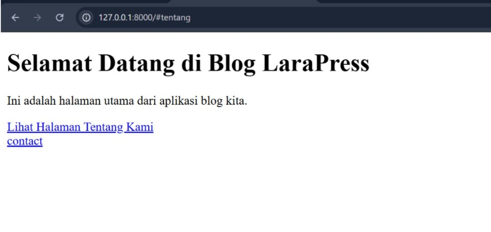
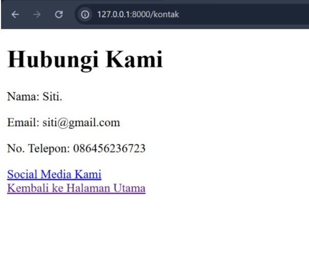
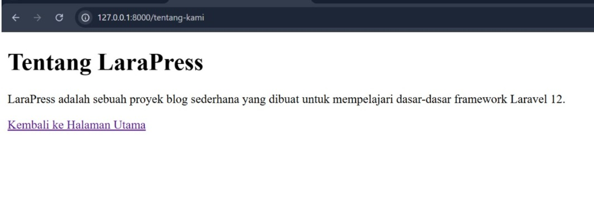

# Laporan Tugas Praktikum 3 - Framework Laravel (LaraPress)

---

**Nama:** Maghfiroh Lisabiliana  
**NIM:** 4524210040  
**Kelas:** A

---

Proyek ini merupakan hasil pengerjaan Tugas Praktikum 3 Pemrograman Web, yang berfokus pada instalasi, konfigurasi dasar, dan pengenalan *routing* pada framework Laravel.

## 1. Dokumentasi Tampilan Website (Screenshots)

Berikut adalah hasil tangkapan layar dari proyek Laravel yang telah dijalankan:

### A. Tampilan Halaman Utama Laravel (Welcome Page)

> **Keterangan:** Tampilan *default* halaman awal saat *server* lokal Laravel berhasil dijalankan menggunakan perintah `php artisan serve`.

### B. Tampilan Halaman Hasil Modifikasi / Routing Baru

**Halaman Kontak:**

**Halaman Tentang Kami:**

> **Keterangan:** Tampilan halaman tambahan yang dibuat dengan menambahkan *route* dan *view* baru pada Laravel.

---

## 2. Cara Menjalankan Proyek (Local Development)
1. Buka terminal di dalam folder proyek.
2. Jalankan perintah: `php artisan serve`
3. Buka browser dan akses URL: `http://localhost:8000`

---

## 3. Teknologi yang Digunakan
- PHP
- Framework Laravel
- HTML & CSS