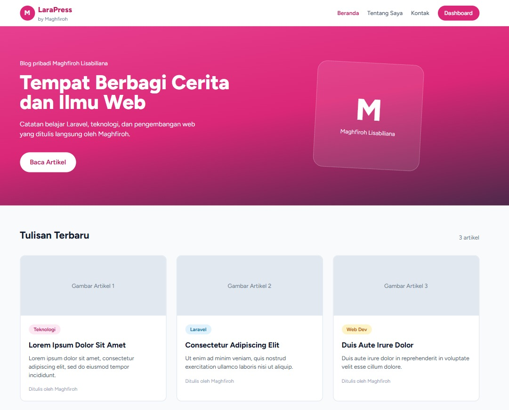
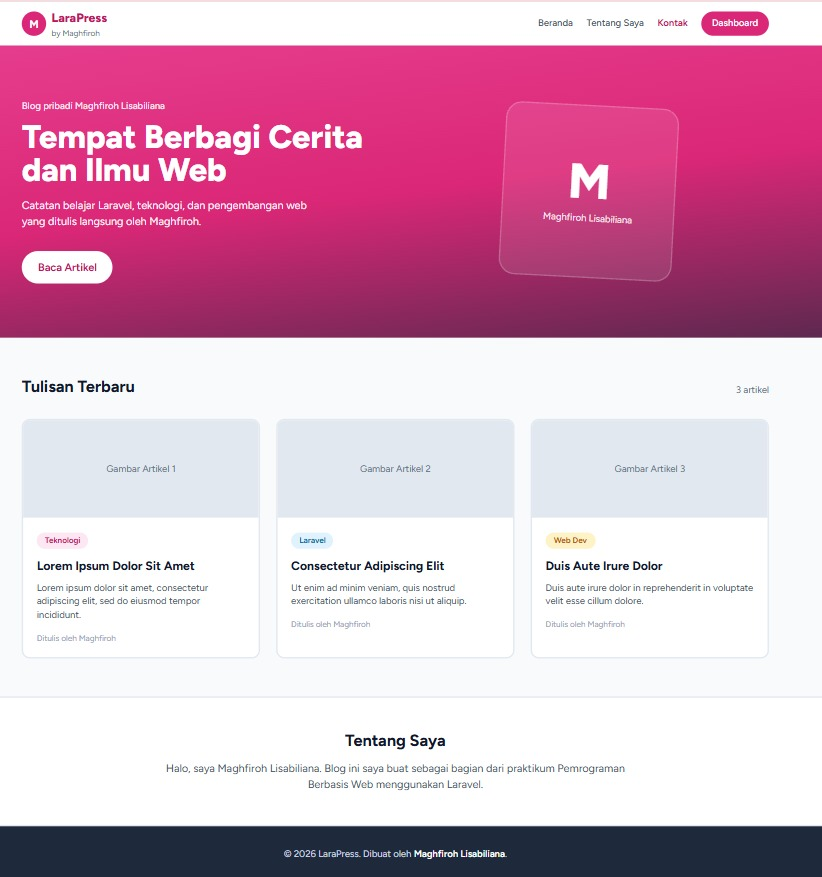
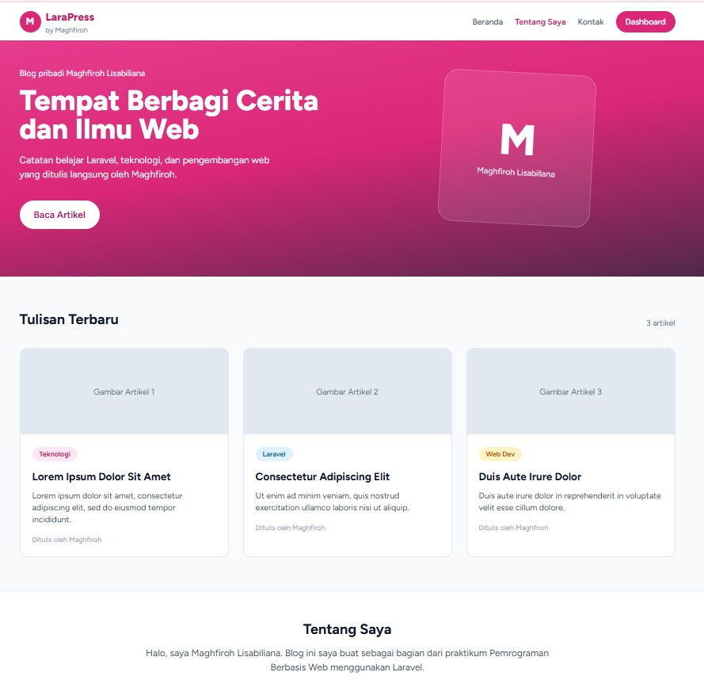
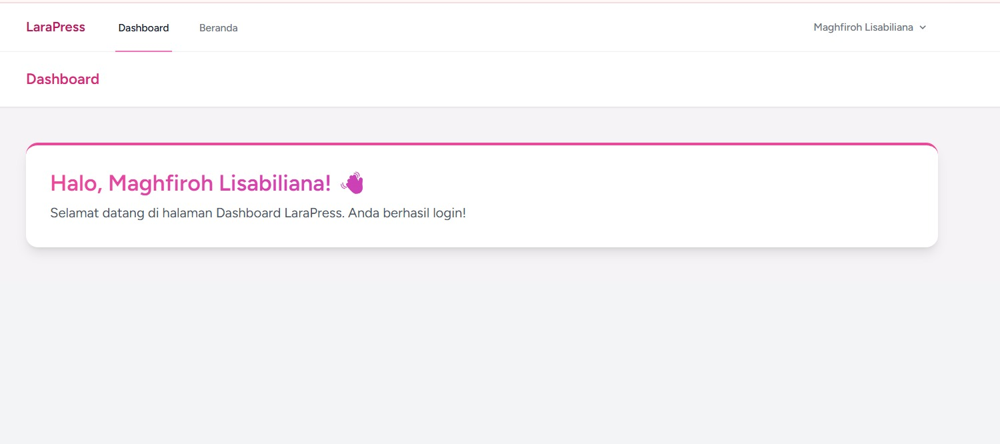
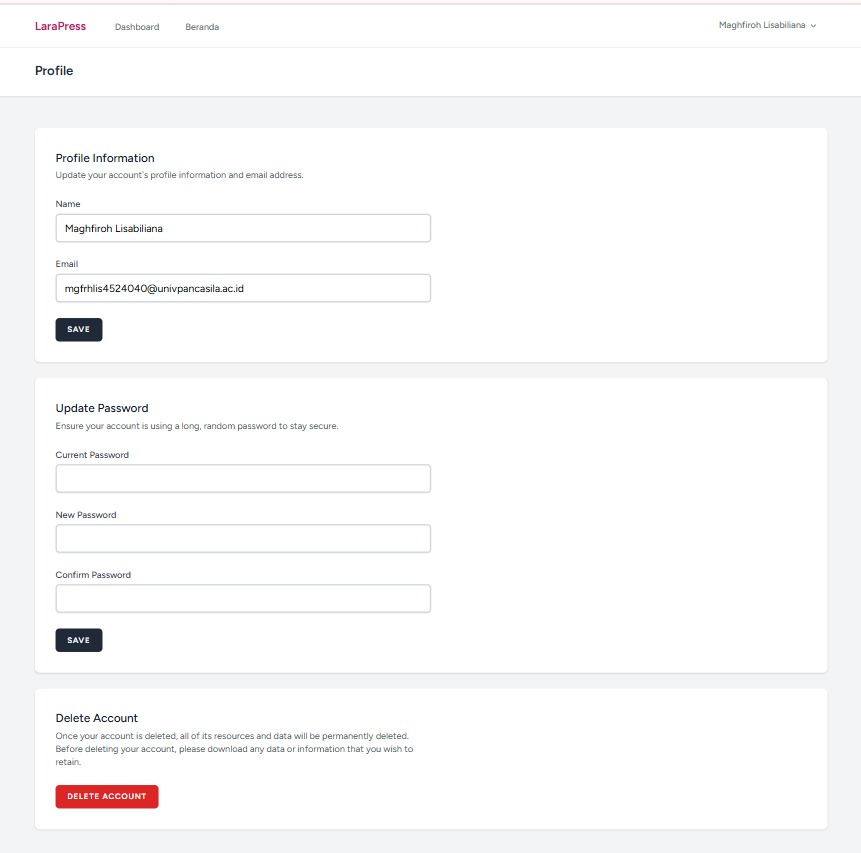

# Laporan Tugas Praktikum 4 - LaraPress Blog Pribadi Berbasis Laravel

**Nama:** Maghfiroh Lisabiliana  
**NIM:** 4524210040  
**Kelas:** A 

---

Proyek **LaraPress** adalah blog pribadi sederhana yang dibangun menggunakan framework **Laravel** sebagai bagian dari tugas Praktikum Pemrograman Berbasis Web. Aplikasi ini memiliki halaman publik (beranda, tentang saya, kontak) serta halaman dashboard yang hanya bisa diakses setelah login. 

---

## 1. Deskripsi Singkat

LaraPress menampilkan catatan belajar Laravel, teknologi, dan pengembangan web. Aplikasi ini terdiri dari dua area utama:

* **Area Publik:** halaman beranda dengan hero section dan daftar tulisan terbaru, bagian "Tentang Saya", serta footer.
* **Area Terautentikasi:** dashboard dan halaman profil yang muncul setelah pengguna berhasil login (fitur autentikasi bawaan Laravel).

## 2. Fitur Utama

* **Halaman Beranda:** hero section bergradasi pink dengan tombol *Baca Artikel* dan kartu identitas bergaya *glassmorphism*.
* **Daftar Tulisan Terbaru:** tiga kartu artikel lengkap dengan label kategori (Teknologi, Laravel, Web Dev), judul, ringkasan, dan nama penulis.
* **Bagian Tentang Saya:** perkenalan singkat pemilik blog.
* **Navigasi Dinamis:** menu *Beranda*, *Tentang Saya*, *Kontak*, dan tombol *Dashboard*; menu yang sedang aktif ditandai dengan warna berbeda.
* **Autentikasi Pengguna:** login dan akses dashboard yang terproteksi.
* **Dashboard:** kartu sambutan yang menampilkan nama pengguna yang sedang login.
* **Manajemen Profil:** ubah nama dan email, ganti password, serta hapus akun.
* **Desain Responsif:** tampilan berbasis kartu dengan tema warna pink dan footer gelap.

## 3. Teknologi yang Digunakan

| Komponen | Keterangan |
|---|---|
| Framework | Laravel |
| Bahasa | PHP |
| Templating | Blade |
| Autentikasi | Laravel (login, profil, hapus akun) |
| Styling | CSS (desain kartu, gradien, *rounded corner*) |
| Local Server | Laragon |

## 4. Instalasi dan Menjalankan Proyek

1. **Clone repository**
   ```bash
   git clone <url-repository>
   cd larapress
   ```
2. **Install dependensi**
   ```bash
   composer install
   npm install
   ```
3. **Salin file environment dan generate key**
   ```bash
   cp .env.example .env
   php artisan key:generate
   ```
4. **Atur koneksi database** pada file `.env`, lalu jalankan migrasi
   ```bash
   php artisan migrate
   ```
5. **Build aset frontend**
   ```bash
   npm run build
   ```
6. **Jalankan server**
   ```bash
   php artisan serve
   ```
   Buka `http://127.0.0.1:8000` pada browser.

## 5. Struktur Halaman

| Halaman | Akses | Keterangan |
|---|---|---|
| Beranda | Publik | Hero section, tulisan terbaru, tentang saya, footer |
| Tentang Saya | Publik | Perkenalan singkat pemilik blog |
| Kontak | Publik | Informasi kontak |
| Dashboard | Login | Kartu sambutan pengguna |
| Profil | Login | Edit profil, ganti password, hapus akun |

## 6. Tampilan Aplikasi

### 1. Halaman Beranda

Bagian atas beranda berisi navbar, hero section, dan daftar *Tulisan Terbaru*.



---

### 2. Halaman Beranda (Kontak)

Menampilkan kartu artikel, bagian *Tentang Saya*, dan footer.



---

### 3. Bagian Tentang Saya

Menu *Tentang Saya* aktif pada navbar dan halaman menggulir ke bagian perkenalan.



---

### 4. Dashboard

Halaman yang tampil setelah pengguna berhasil login.



---

### 5. Halaman Profil

Berisi tiga bagian: *Profile Information*, *Update Password*, dan *Delete Account*.


