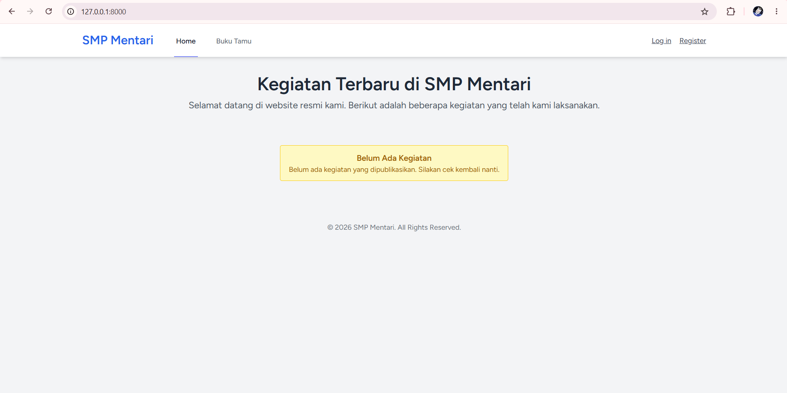
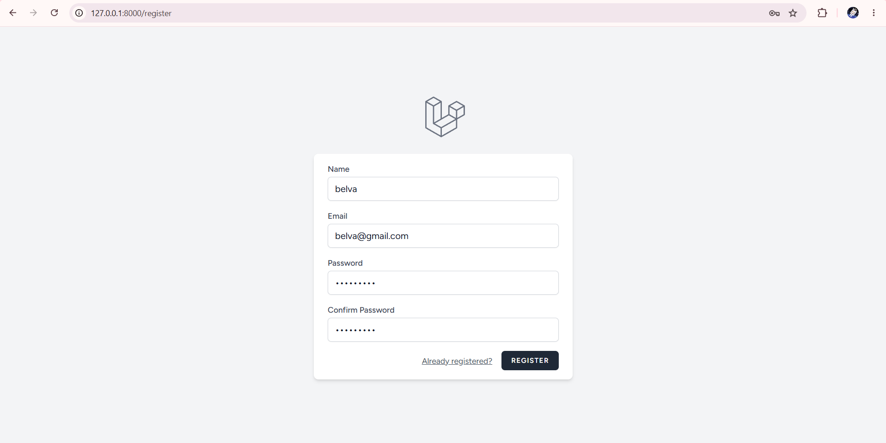
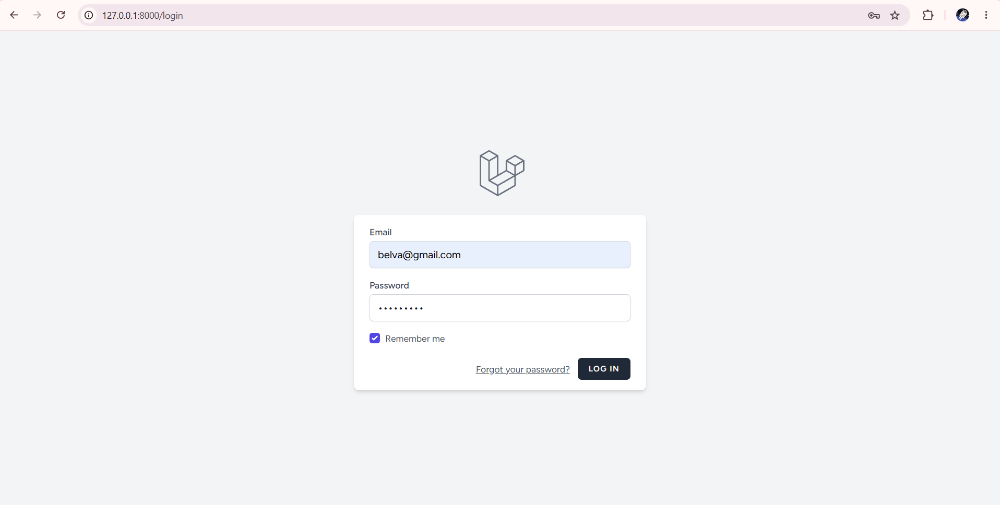

# 📘 Laporan Praktikum Pertemuan Ke - 4

🧑‍🎓 **Nama:** Belvaria Hendriyani  
🔢 **NPM:** 4524210078  
🏫 **Mata Kuliah:** Pemrograman Berbasis Web

---

# 🏫 Website SMP Mentari Ceria

Aplikasi website sekolah berbasis Laravel yang menampilkan informasi kegiatan sekolah dan fitur buku tamu digital untuk SMP Mentari Ceria.

<p align="center">
  
  
  
  
</p>

---

## 📋 Daftar Isi

- [Tentang Aplikasi](#-tentang-aplikasi)
- [Fitur Utama](#-fitur-utama)
- [Tech Stack](#-tech-stack)
- [Instalasi](#-instalasi)
- [Penggunaan](#-penggunaan)
- [Hasil Screenshot Tampilan Website SMP Mentari](#-hasil-screenshot-tampilan-website-smp-mentari)

---

## 🎯 Tentang Aplikasi

Website **SMP Mentari Ceria** adalah aplikasi web sederhana yang dibangun dengan **Laravel 12** untuk menampilkan informasi dan kegiatan sekolah. Aplikasi ini dilengkapi dengan fitur buku tamu digital yang memungkinkan pengunjung meninggalkan pesan dan kesan mereka, serta panel dashboard untuk mengelola data kegiatan dan buku tamu.

### Fitur Halaman:

1. **Halaman Home:** Menampilkan kegiatan-kegiatan terbaru sekolah.
2. **Buku Tamu:** Formulir interaktif untuk pengunjung meninggalkan pesan.
3. **Autentikasi:** Sistem login dan register untuk admin/pengelola.
4. **Dashboard Admin:** Pusat kendali untuk mengelola kegiatan dan pesan buku tamu.

---

## ✨ Fitur Utama

- ✅ **Tampilan Kegiatan Sekolah:** Showcase kegiatan terbaru dengan _card design_.
- ✅ **Buku Tamu Digital:** Pengunjung dapat meninggalkan pesan dan masukan.
- ✅ **Form Validasi:** Validasi input untuk nama, email, dan pesan.
- ✅ **Real-time Feedback:** Notifikasi sukses/error setelah submit.
- ✅ **Responsive Design:** Tampilan optimal di semua perangkat (_device_).
- ✅ **Timestamp Relatif:** Menampilkan waktu pesan (contoh: "2 jam yang lalu").
- ✅ **Modern UI/UX:** Desain _clean_ menggunakan Tailwind CSS.
- ✅ **Dashboard Management:** Pengelolaan postingan kegiatan dan entri buku tamu oleh admin.

---

## 🛠️ Tech Stack

### Backend

- **Laravel 12.x** - PHP Framework
- **PHP ^8.2** - Programming Language
- **MySQL / MariaDB** - Database
- **Eloquent ORM** - Database Management

### Frontend

- **Blade Templates** - Template Engine
- **Tailwind CSS 4.0** - CSS Framework
- **Vite 7.0** - Asset Bundler & HMR

---

## 🚀 Instalasi

Ikuti langkah-langkah di bawah ini untuk menjalankan proyek secara lokal:

### 1. Clone Repository

```bash
git clone [https://github.com/belvahndryn/Prak_PBW_A_BelvariaHendriyani_24078.git](https://github.com/belvahndryn/Prak_PBW_A_BelvariaHendriyani_24078.git)
cd SMP-Mentari
```

---

### 2. `Install Dependencies`

````markdown
### 2. Install Dependencies

```bash
composer install
npm install
```
````

---

### 3. `Setup Environment`

````markdown
### 3. Setup Environment

```bash
copy .env.example .env
php artisan key:generate
```
````

---

### 4. `Setup Database` (Kredensial .env)

````markdown
### 4. Setup Database

Buka file `.env` dan sesuaikan konfigurasi database Anda di Laragon:

```env
DB_CONNECTION=mysql
DB_HOST=127.0.0.1
DB_PORT=3306
DB_DATABASE=db_smp_mentari
DB_USERNAME=root
DB_PASSWORD=
```
````

```bash
php artisan migrate
```

---

### 5. `Penggunaan` (Menjalankan Server)

````markdown
## 💻 Penggunaan

**Terminal 1 (Backend Server):**

```bash
php artisan serve
```
````

```bash
npm run dev
Aplikasi dapat diakses melalui browser pada alamat: [http://127.0.0.1:8000]
```

📸 Hasil Screenshot Tampilan Website SMP Mentari

### 1. Halaman Home

> 

### 2. Halaman Buku Tamu


### 3. Halaman Register & Login

|     Halaman Register     |     Halaman Login     |
| :----------------------: | :-------------------: |
|  |  |

### 4. Halaman Dashboard Admin


