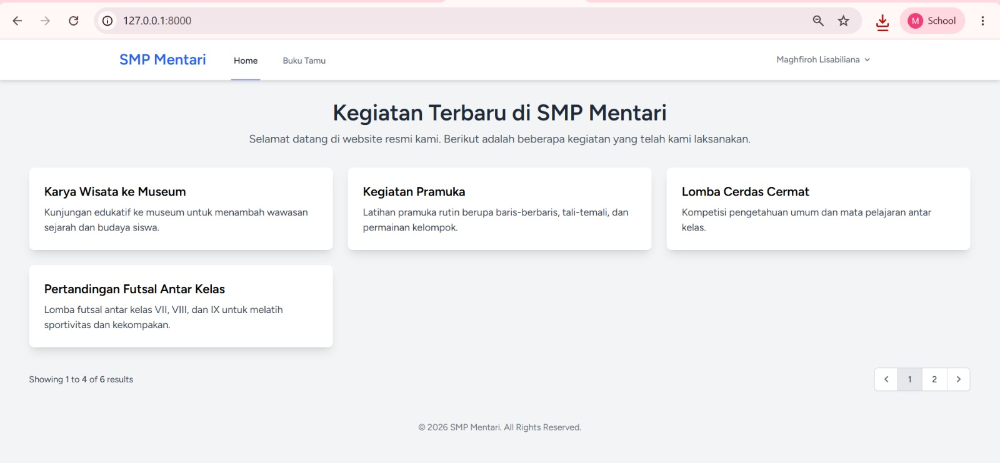
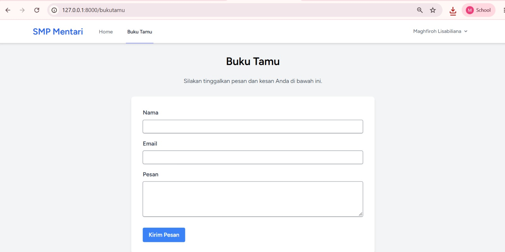
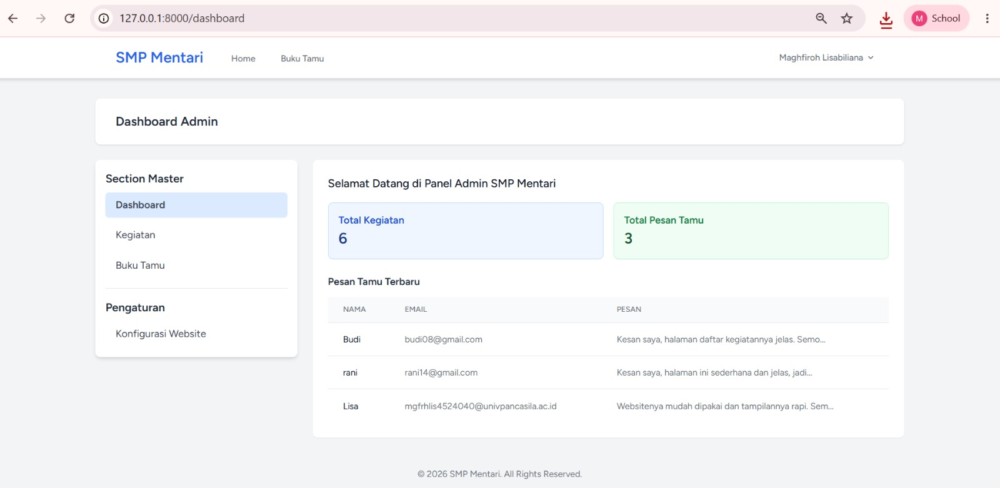
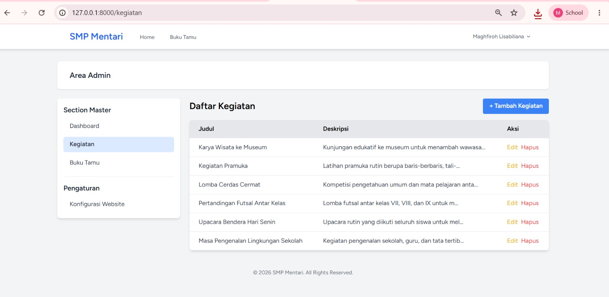
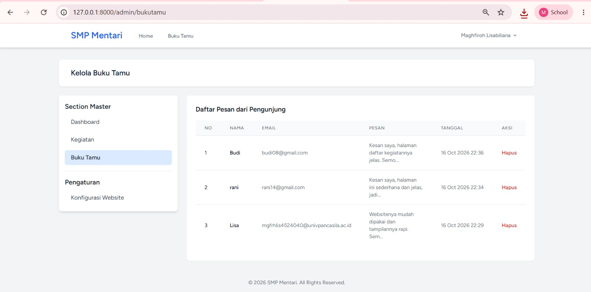
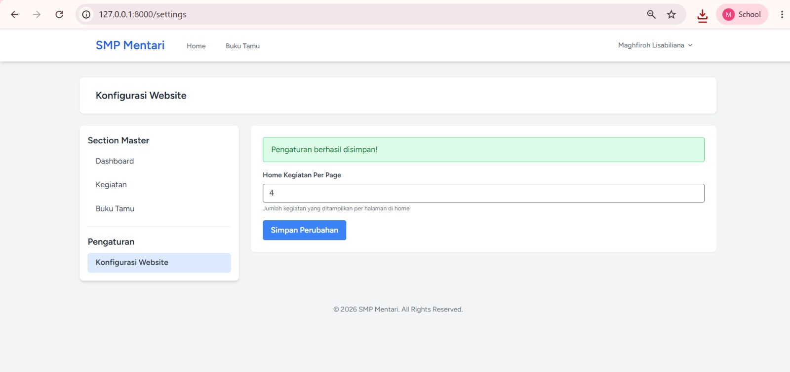

# Laporan Tugas Praktikum 5 - Website SMP Mentari 

**Nama:** Maghfiroh Lisabiliana  
**NIM:** 4524210040  
**Kelas:** A

---

## 1. Deskripsi Program
Website SMP Mentari adalah website sekolah yang menampilkan kegiatan terbaru dan menyediakan buku tamu bagi pengunjung. Website juga memiliki panel admin yang dilindungi login untuk mengelola kegiatan, pesan buku tamu, dan pengaturan tampilan. Program berhasil dijalankan melalui *local server* pada alamat `127.0.0.1:8000`.

**Tech Stack:** PHP 8.2+, Laravel 12, Laravel Breeze (autentikasi), Tailwind CSS v4, MySQL / SQLite.

## 2. Fitur Program

**Pengunjung**
* **Halaman Home:** Menampilkan daftar kegiatan terbaru dalam bentuk *card* lengkap dengan *pagination*.
* **Buku Tamu:** Form untuk mengirim pesan dan kesan (Nama, Email, dan Pesan).

**Admin (wajib login)**
* **Dashboard:** Menampilkan total kegiatan, total pesan tamu, dan pesan tamu terbaru.
* **Kelola Kegiatan:** Menambah, mengedit, dan menghapus kegiatan (CRUD).
* **Kelola Buku Tamu:** Melihat dan menghapus pesan pengunjung.
* **Konfigurasi Website:** Mengatur jumlah kegiatan yang tampil per halaman di Home.

## 3. Penjelasan 5 Bagian Kode Penting

* ### Pengaturan Dinamis dengan Cache
    ```php
    Cache::remember("setting.{$key}", 3600, function () use ($key, $default) { ... });
    ```
    *Penjelasan:* Nilai pengaturan disimpan di *cache* selama 1 jam agar tidak selalu membaca database.

* ### Pagination Mengikuti Pengaturan
    ```php
    $kegiatan_terbaru = Kegiatan::latest()->paginate($perPage);
    ```
    *Penjelasan:* Jumlah kegiatan per halaman di Home diambil dari pengaturan, bukan ditulis tetap di kode.

* ### Validasi Form Buku Tamu
    ```php
    'email' => 'required|email|max:255',
    ```
    *Penjelasan:* Nama, email, dan pesan wajib diisi, dan email harus berformat benar sebelum disimpan.

* ### Proteksi Rute Admin
    ```php
    Route::middleware('auth')->group(function () { Route::resource('kegiatan', KegiatanController::class); });
    ```
    *Penjelasan:* Halaman admin hanya bisa dibuka setelah login, dan `Route::resource` membuat seluruh rute CRUD kegiatan sekaligus.

* ### Form Hapus yang Aman
    ```html
    @csrf
    @method('DELETE')
    ```
    *Penjelasan:* `@csrf` mencegah permintaan palsu, dan `@method('DELETE')` membuat form dikenali sebagai permintaan hapus.

## 4. Screenshot Aplikasi

### 1. Halaman Home



<br>

---

### 2. Halaman Buku Tamu



<br>

---

### 3. Dashboard Admin



<br>

---

### 4. Kelola Kegiatan



<br>

---

### 5. Kelola Buku Tamu



<br>

---

### 6. Konfigurasi Website



## 5. Cara Menjalankan

```bash
composer install
npm install
php artisan migrate
composer dev
```

Setelah itu buka `http://127.0.0.1:8000` di browser. Untuk masuk ke panel admin, daftar akun melalui halaman Register, lalu login.