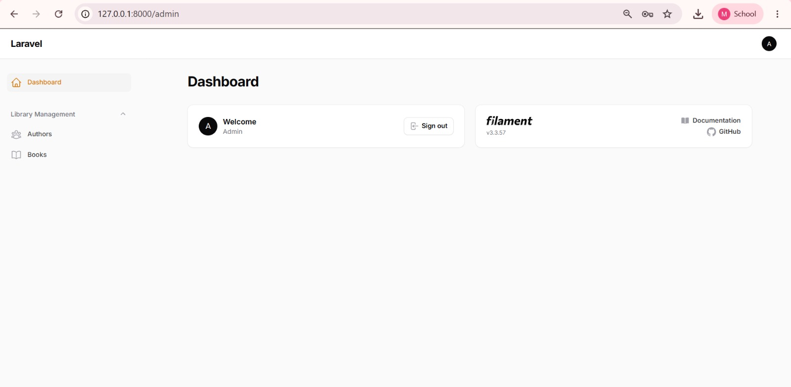
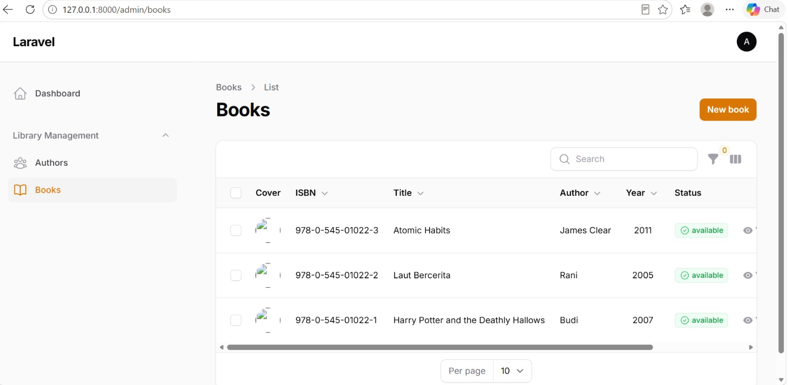
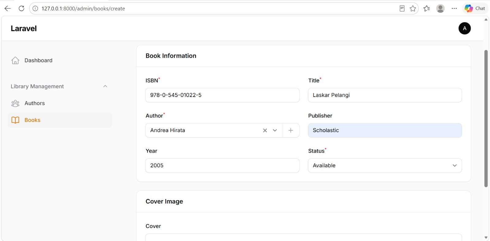
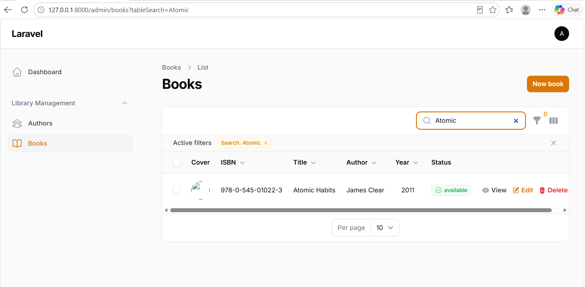
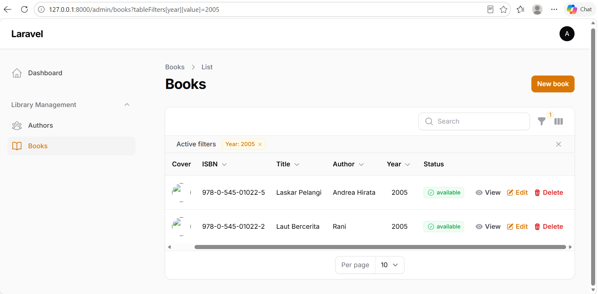

# Laporan Tugas Praktikum 6 

**Nama:** Maghfiroh Lisabiliana  
**NIM:** 4524210040  
**Kelas:** A 

---

## Tugas 1: Implementasi Dasar 

Berikut adalah bukti implementasi dari seluruh langkah Praktikum 6 sesuai dengan instruksi tugas:

### 1. Screenshot admin panel yang berhasil login
  
*Keterangan: Halaman dashboard admin panel setelah berhasil melakukan proses autentikasi (login).*

### 2. Screenshot list books dengan data yang terseed
  
*Keterangan: Tabel daftar buku (list books) yang telah terisi banyak data secara otomatis hasil eksekusi database seeder.*

### 3. Screenshot form create book
  
*Keterangan: Tampilan antarmuka formulir (form) yang difungsikan untuk menambahkan data buku baru ke dalam database.*

### 4. Screenshot hasil pencarian
  
*Keterangan: Menampilkan tabel list books saat fitur pencarian (search) digunakan untuk mencari judul atau pengarang tertentu.*

### 5. Screenshot filter aktif
  
*Keterangan: Tampilan data buku ketika penyaringan (filter) berdasarkan kategori atau kriteria spesifik sedang diterapkan.*
