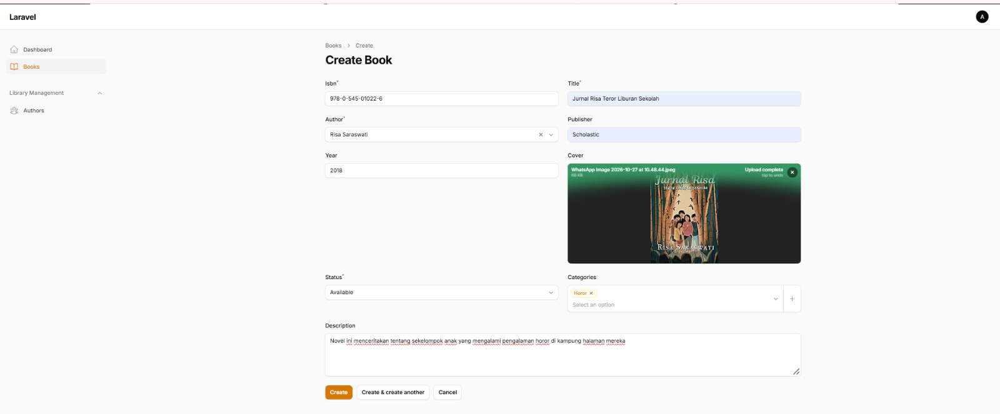
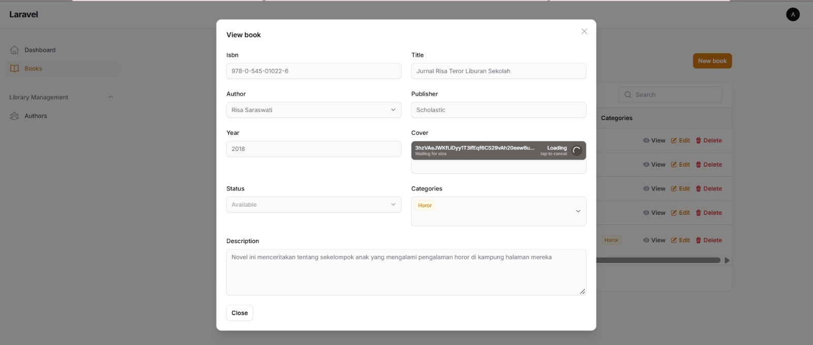
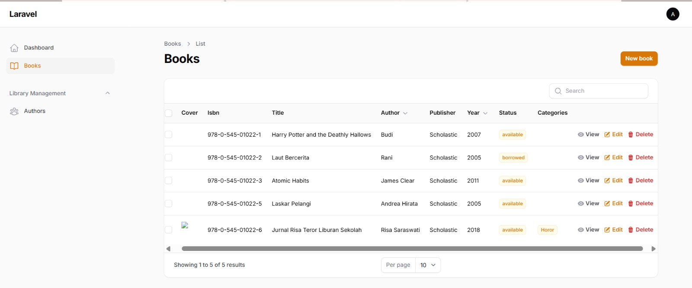
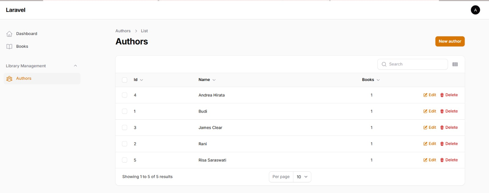
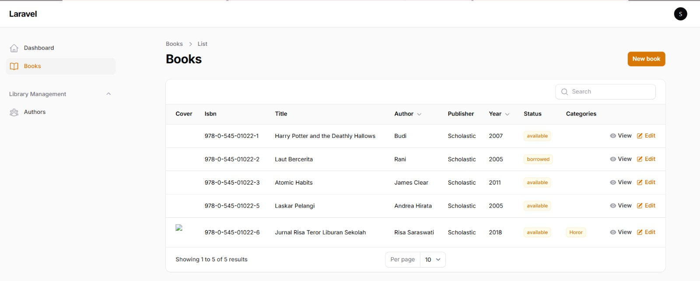
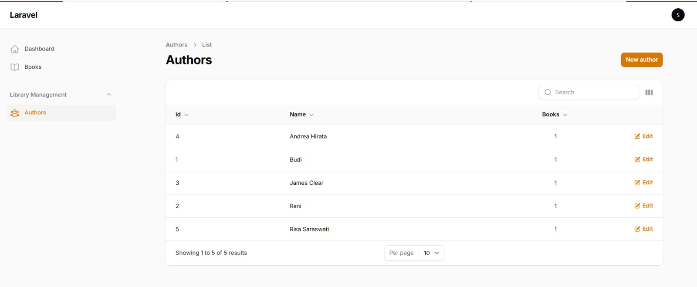
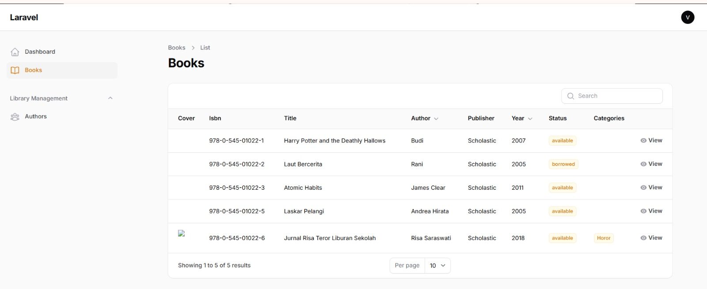
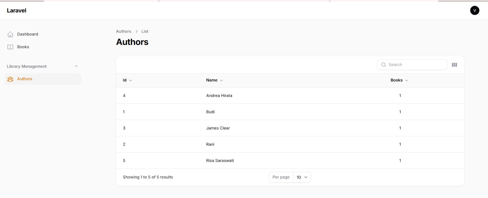
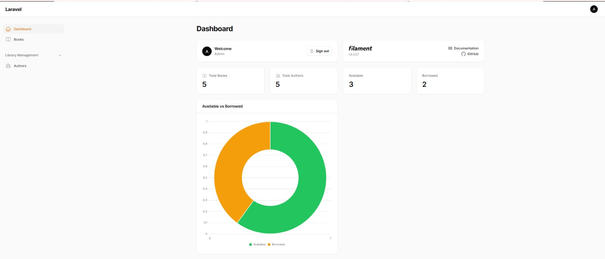

# Laporan Tugas Praktikum 7

**Nama:** Maghfiroh Lisabiliana  
**NIM:** 4524210040  
**Kelas:** B

---

## Tugas 2: Kustomisasi dan Pengembangan 

Aplikasi manajemen perpustakaan berbasis **Laravel 12** dan **Filament 3.3.57** dengan empat fitur tambahan: field description, role-based access, widget dashboard, dan kategori buku.

### Akun Login

| Role | Email | Password |
|---|---|---|
| Admin | admin@example.com | password |
| Staff | staff@example.com | password |
| Viewer | viewer@example.com | password |

---

### 1. Tambah Field Description pada Book 

- **Migration:** `add_description_to_books_table` menambah kolom `description` (text, nullable).
- **Model:** `description` ditambahkan ke `$fillable` pada `app/Models/Book.php`.
- **Resource:** komponen `Textarea` pada form di `app/Filament/Resources/BookResource.php`.
- **Factory:** `'description' => fake()->paragraph()` pada `database/factories/BookFactory.php`.

Form Create Book (Description):

Detail buku yang tersimpan (Description):

---

### 2. Implementasi Role-Based Access 

- **Migration:** `add_role_to_users_table` menambah kolom `role` (default `viewer`).
- **Model User:** `role` di `$fillable` serta method `isAdmin()`, `isStaff()`, dan `isViewer()`.
- **Seeder:** `UserSeeder` membuat 3 user dengan role berbeda (admin, staff, viewer).
- **Policy:** `BookPolicy` dan `AuthorPolicy` dengan aturan berikut.

| Role | View | Create | Edit | Delete |
|---|---|---|---|---|
| Admin | Ya | Ya | Ya | Ya |
| Staff | Ya | Ya | Ya | Tidak |
| Viewer | Ya | Tidak | Tidak | Tidak |

**Admin (semua akses)**

Books:

Authors:

**Staff (create, edit, view; tanpa Delete)**

Books:

Authors:

**Viewer (hanya View)**

Books:

Authors:

---

### 3. Tambah Widget Dashboard 

- `BookStatsOverview`: menampilkan **Total Books**, **Total Authors**, **Available**, dan **Borrowed**.
- `BookStatusChart`: chart doughnut perbandingan buku **Available vs Borrowed**.
- Lokasi file: `app/Filament/Widgets/`

---

### 4. Tambah Kategori Buku 

- **Model:** `Category` (`app/Models/Category.php`).
- **Relasi many-to-many:** `Book::categories()` dan `Category::books()` melalui tabel pivot `book_category`.
- **Form:** field `Select` dengan `multiple()` pada form Book, kategori tampil sebagai badge di tabel.
- **Seeder:** kategori awal Fiction, Science, History, dan Technology.

Form Create Book (Categories multiple select):

Kolom Categories pada tabel Books:

---